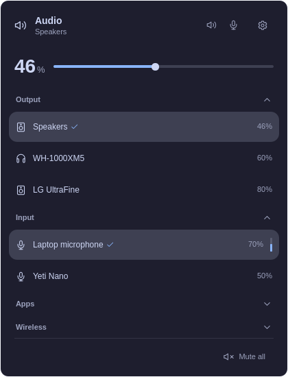

# Foamy Audio

Audio outputs, microphones, app volume and AirPlay for the Omarchy bar.



## Install

```sh
omarchy plugin add https://github.com/foamrider/foamy-audio.git --enable
```

Remove the stock audio widget from the bar when replacing it. Built for
Omarchy 4.5; it also loads on Omarchy 4.0.

Requires PipeWire (with `pipewire-pulse` for `pactl`) and Python 3.

Optional:

- AirPlay: `pipewire-zeroconf` (RAOP discovery) and `avahi` (`avahi-browse`).
- Microphone level for non-stereo inputs (mono, Pro Audio AUX): `pw-record`,
  part of `pipewire`.
- AirPlay firewall rules: `ufw`, `polkit` (`pkexec`) and `iproute2` (`ip`).

## Use

- Left-click the widget to open the panel; right-click mutes or unmutes
  output and microphone together. Scrolling never changes volume.
- Select a device row to switch to it. The cursor row shows its volume
  slider; expand Apps for per-app volume.
- Expand Wireless and tick one or more AirPlay speakers. Tick a speaker again
  to remove it from the group; removing the last one returns to local audio.
  Each speaker keeps its own level. Discovery runs while the panel is open and
  stops when it closes with no AirPlay output selected (and when the plugin is
  disabled or removed).
- The bar volume and mute follow the physical output behind a speaker tuning
  or EasyEffects, the same sink the volume keys use. It is re-resolved when
  the output, the PipeWire graph or EasyEffects' output changes; nothing polls.
- On Omarchy 4.5, nodes a platform's audio processing adds are hidden, and a
  virtual default input (EasyEffects, a platform microphone mapping) gets
  volume and mute through `wpctl`, like the stock panel.

Keyboard: arrows or `hjkl` move the cursor, `h`/`l` change the cursor row's
volume, Enter or Space activates, `m` mutes the cursor target, `o`/`i`/`a`/`w`
fold Output, Input, Apps and Wireless, `s` opens Settings, Tab and Shift-Tab
switch to the next bar panel, Esc closes. Hovering moves the same cursor.

## Settings

Open the cog (or press `s`).

- **Show percentage in the bar** (on by default). Saved to the widget's entry
  in Omarchy's `shell.json`.
- **AirPlay firewall.** PipeWire receives timing and control traffic from each
  speaker on UDP 6001–6002, so a firewall can allow discovery and selection
  while blocking sound. **Verify** reads the live UFW rules and checks that
  each speaker found can reach those ports. **Apply** adds one rule per
  network the speakers are on:
  `ufw allow in on <interface> proto udp from <subnet> to any port 6001:6002`
  (the speaker's own address if it is routed). The ports stay closed on any
  other network. **Remove** deletes the rules Foamy Audio added, and the
  unrestricted `6001:6002/udp` rule of version 1.0 when Verify found it.
  Applied rules are recorded in `$XDG_STATE_HOME/foamy-audio/firewall.json`.
  Each action asks for administrator authorization through Polkit (Remove
  once per rule). Only `/usr/bin/ufw` is elevated, with arguments the plugin
  builds. It does not enable an inactive firewall, and it covers UFW only, not
  other firewalls or router rules.

Microphone metering uses Quickshell for stereo inputs. Other channel layouts
use `pw-record` with the input's channel map (8 kHz for inputs with more than
8 channels). Capture runs only while the panel is open; only level numbers
leave the helper and no audio is saved or sent. During AirPlay the meter
captures passively, so opening the panel does not wake the microphone and
disturb the playback clock.

Language follows **Omarchy → Setup → Language** on Omarchy 4.5 (English and
Norwegian catalogs; right-to-left languages mirror the panel). Omarchy 4.0
shows English.

## Remove

Select a local output (untick all AirPlay speakers), and use **Settings →
AirPlay firewall → Remove** if you applied rules, then:

```sh
omarchy plugin remove foamy.audio
```

Restore the stock audio widget through the bar settings if needed. Device
volumes and selections stay as last set. Removing the plugin does not
uninstall PipeWire, Avahi or other packages.

## Development

```sh
node tests/model.test.js && node tests/preferences.test.js && node tests/i18n.test.cjs
python3 -I tests/test_airplay_bridge.py && python3 -I tests/test_microphone_peak.py && python3 -I tests/test_ufw_check.py
bash tests/kit-check.sh
python3 -I tests/runtime.py   # offscreen, 4.0 and 4.5 hosts; needs foamy-kit (FOAMY_KIT)
```

Shared components live in `kit/`, copied from
[foamy-kit](https://github.com/foamrider/foamy-kit); change them there and
run its `sync.sh`. `preview/Preview.qml` holds mock states for the kit's
screenshot harness.

## License

Licensed under [MIT](LICENSE). Omarchy and Lucide notices are in
[LICENSE-OMARCHY](LICENSE-OMARCHY) and [LICENSE-LUCIDE](LICENSE-LUCIDE).

Provided **as is**, without warranty or guaranteed support. Use at your own risk.
